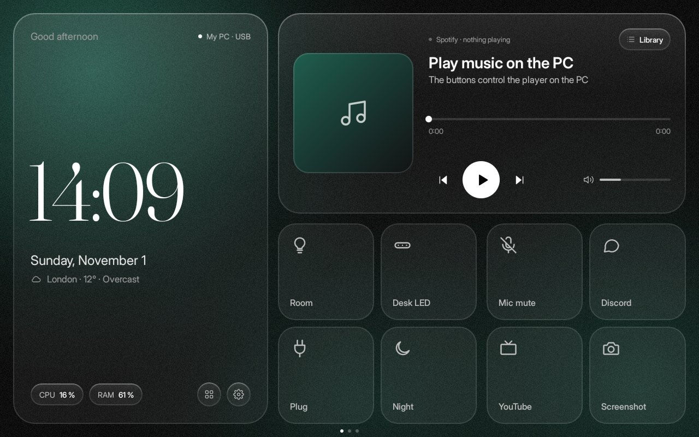
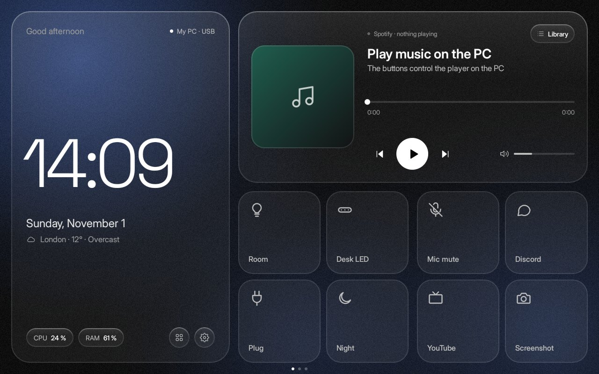
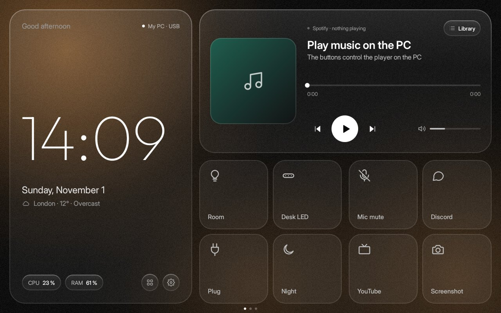
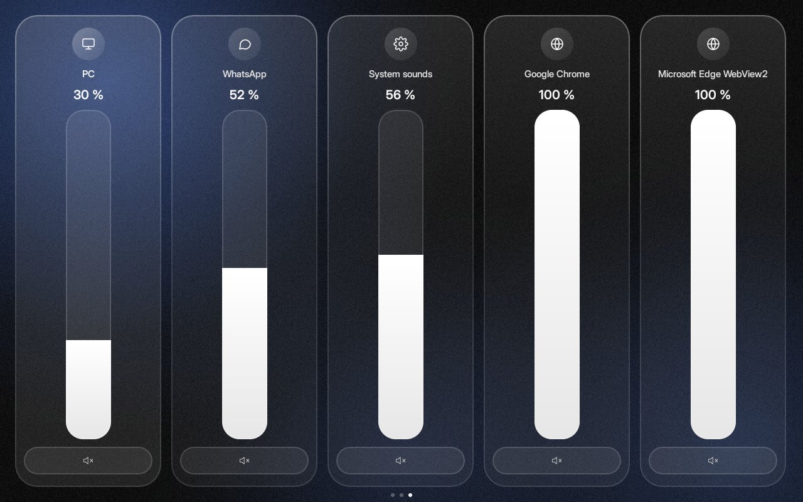
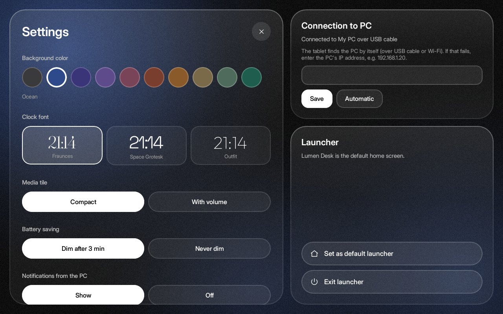

# Lumen Desk

**Give your old Android tablet a new job: a beautiful control panel that sits next to your Windows PC.**

See the time and weather, control Spotify, change the volume of every app, switch your lights, run shortcuts with one tap – or use the tablet as a **second monitor**. Everything is set up from a simple window on your PC.

<table>
  <tr>
    <td></td>
    <td></td>
  </tr>
  <tr>
    <td></td>
    <td></td>
  </tr>
  <tr>
    <td align="center">Pick a color and a clock font</td>
    <td align="center">…right on the tablet or on the PC</td>
  </tr>
</table>

---

## What can it do?

| | |
|---|---|
| 🕒 **Clock & weather** | A big clock, the date, the weather and your PC's CPU / RAM usage. |
| 🎵 **Spotify** | See what's playing, pause, skip, seek – and browse your playlists and liked songs. Tap a song and it plays on your PC. |
| 🔊 **Volume mixer** | One slider for the whole PC and one for every app that plays sound (Spotify, Discord, your browser, games…). |
| ⚡ **One-tap tiles** | Open apps, files or websites (even in a specific browser profile), press keyboard shortcuts, mute your mic, lock or sleep the PC. |
| 💡 **Smart lights** | Turn Yeelight bulbs on and off. |
| 🖥️ **Second monitor** | The tablet becomes an extra screen for your PC – touch works like a mouse. |
| 🔔 **Notifications** | Messages from Discord, WhatsApp and other apps pop up on the tablet. |
| 🎨 **Your style** | 10 background colors, 3 clock fonts, multiple pages and layouts. |

**Everything is set up on your PC** – click a tile to choose what it does, drag tiles around, add pages:

---

## What you need

- A **Windows 10 or 11** PC
- An **Android tablet** with Android 7 or newer (old tablets are perfect)
- Both on the **same Wi-Fi** – or connected with a USB cable
- Optional: **Spotify Premium** for the music controls

---

## Set it up (about 5 minutes)

### Step 1 – On your PC
1. Download **`LumenDeskSetup.exe`** from the [Releases](../../releases) page (on the right side of this page).
2. Run it and click **Next → Install → Finish**.

That's it for the PC. Lumen Desk runs in the background, starts with Windows, and the **Lumen Desk** icon on your desktop opens the settings. Uninstall it any time in *Windows Settings → Apps*.

> **"Windows protected your PC"?** The installer is not code-signed (that costs money for a free project), so Windows warns about it the first time. Click **More info → Run anyway**.

### Step 2 – On your tablet
1. Download **`lumen-desk.apk`** from the [Releases](../../releases) page (on the right side of this page) – open the link directly on the tablet, or copy the file over.
2. Open the file to install it. If Android asks, allow installing apps from this source.
3. Open **Lumen Desk** on the tablet. It finds your PC by itself.

### Step 3 – Allow the tablet
The tablet shows a 6-digit code. On the PC, open the **Lumen Desk** settings → **Tablet**, check that the same code is shown there and click **Allow**. You only need to do this once.

Done! 🎉 Now make it yours: in the settings window click a tile to change what it does, drag tiles around, add pages, or pick a color under **Appearance**.

**Tip:** to make Lumen Desk the tablet's home screen, open the ⚙ settings on the tablet (bottom right of the clock card) → **Set as default launcher**.

---

## Extras (optional)

<b>Spotify</b> – control music and browse your library

1. In the Lumen Desk settings on the PC, open **Spotify**.
2. Follow the three steps shown there: create a free app at [developer.spotify.com](https://developer.spotify.com/dashboard), paste the redirect address it shows, tick **Web API**, and copy the **Client ID** back.
3. Click **Log in to Spotify**.

Without this, the play / next / previous buttons still work (as media keys).

<b>Smart lights</b> (Yeelight)

1. In the Yeelight app, open each bulb → Settings → turn on **LAN Control**.
2. In the Lumen Desk settings: **Lights** → **Search for bulbs**.
3. Click a tile, set *Action* to **Light** and pick the bulb.

<b>Second monitor</b> – use the tablet as an extra screen

1. Install the free [Virtual Display Driver](https://github.com/VirtualDrivers/Virtual-Display-Driver/releases) (*VDD.Control* → **Install Driver**). It adds a virtual monitor to Windows.
2. In the Lumen Desk settings open **Tablet → Extras** and click **Install** next to *Second monitor* (it downloads ffmpeg for you).
3. Press **Win + P** → **Extend**. In *Settings → Display*, set the new monitor to your tablet's resolution (e.g. 1280 × 800).
4. In the Lumen Desk settings, add a tile with the action **Second monitor**.

On the tablet: tap = click, drag = drag, hold = right click, two fingers = scroll, **three-finger tap = back** to the panel.

<b>USB cable</b> – faster and steadier than Wi-Fi, and the tablet charges

1. On the tablet, enable **Developer options** (tap *Build number* 7× in *Settings → About tablet*) and turn on **USB debugging**.
2. In the Lumen Desk settings open **Tablet → Extras** and click **Install** next to *USB cable* (it downloads Google's adb tool for you).
3. Plug the tablet in and accept the *Allow USB debugging* prompt. Lumen Desk switches to the cable by itself.

---

## Something doesn't work?

| Problem | Try this |
|---|---|
| The tablet keeps *Looking for PC…* | Make sure both are on the same Wi-Fi and Lumen Desk runs on the PC (desktop icon). Or enter the PC's address manually in the tablet's ⚙ settings. |
| Spotify shows nothing | Start playing something in Spotify on any device first. |
| Some playlists show no songs | Spotify only lets apps list songs of playlists *you* created; others can still be played with **Play** / **Shuffle**. |
| Second monitor is black | Check that Windows shows two displays (Win + P → Extend) and that *Second monitor* shows **Installed** in **Tablet → Extras**. |
| Anything else | The settings window → **Tablet** → *Server status* shows a log of errors. |

---

## Install with an AI assistant

Using **Claude Code**, **Codex** or a similar coding agent? Open this folder and say:

> Install Lumen Desk on my PC and tablet by following AGENTS.md.

It will walk you through every step and ask before doing anything important.

---

## For developers

- `pc/` – Windows server (Node.js 22.5+, no build step). `run.js` supervises `server.js`; libraries in `lib/`, settings UI in `ui/`. Run it from source with `pc/Setup.cmd` or `npm start`.
- `pc/installer/` – builds `LumenDeskSetup.exe` (`npm run installer`): the server is bundled with esbuild, packed with Node.js into one exe (Node single executable application) and wrapped with [Inno Setup](https://jrsoftware.org/isinfo.php). When installed, user data lives in `%APPDATA%\Lumen Desk`.
- `tablet/` – Android app (Kotlin, Jetpack Compose, Android 7.0+). Build with `./gradlew assembleRelease` (JDK 17, Android SDK 34).
- `shared/icons.json` – icons shared by both.

How it works: WebSocket server for the tablet on port 47801, auto-discovery over UDP broadcast (port 47802), the settings window on `http://127.0.0.1:47803` (only reachable from the PC itself), new tablets need approval. Keyboard, mouse, volume and windows are controlled through small PowerShell helpers (Win32 / Core Audio). The second monitor is captured with ffmpeg `ddagrab`, encoded to H.264 and decoded by the tablet's hardware. Notifications are read from the Windows notification database (read-only). Optional env var `LUMEN_PC_NAME` changes the PC name shown on the tablet.

See [AGENTS.md](AGENTS.md) for details.

### Security
- **Encrypted connection.** Every connection starts with a fresh key exchange (ECDH P-256); all messages, including the second-monitor video, are encrypted and authenticated with AES-256-GCM and numbered, so they cannot be read, changed or replayed on the network.
- **Pairing.** A new tablet and the PC show the same 6-digit code; allow the tablet only when they match. The PC then gives the tablet a random 256-bit pairing key, which is mixed into every later connection – the tablet's id alone is worth nothing to an attacker, and the key itself never travels over the network again.
- **Settings stay on the PC.** The settings window and its API listen only on 127.0.0.1:47803 (not forwarded over the USB cable) and accept requests only from the settings page itself (Host, Origin and a custom header are checked), so a web page open in your browser cannot change macros or run programs.
- Pairing keys and the Spotify login are stored in your Windows user profile (`%APPDATA%\Lumen Desk`); anyone who can log into your Windows account can read them.

## Related
**Lumen TV** – the same look as a launcher for Android TV / Google TV.

## Credits
Fonts: [Inter](https://rsms.me/inter/), [Fraunces](https://github.com/undercasetype/Fraunces), [Outfit](https://github.com/Outfitio/Outfit-Fonts), [Space Grotesk](https://github.com/floriankarsten/space-grotesk) (SIL Open Font License). Weather by [Open-Meteo](https://open-meteo.com). Music via the Spotify Web API. Second monitor uses [Virtual Display Driver](https://github.com/VirtualDrivers/Virtual-Display-Driver) and [ffmpeg](https://ffmpeg.org) – both are installed separately by you and keep their own licenses.

## License
[MIT](LICENSE)
