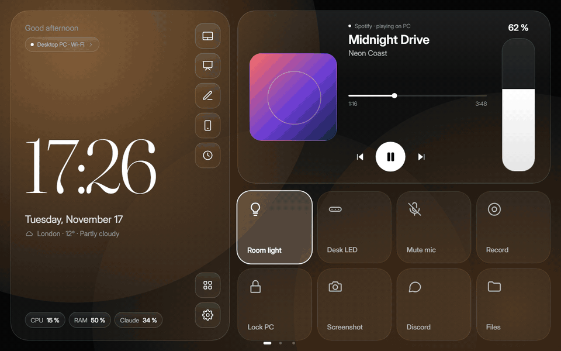
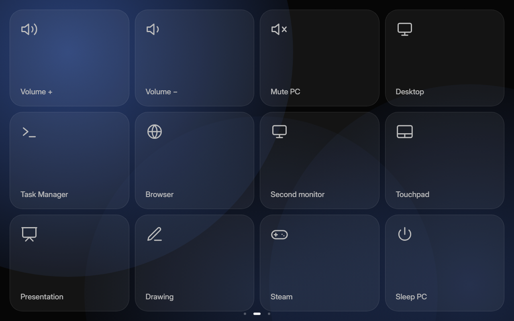
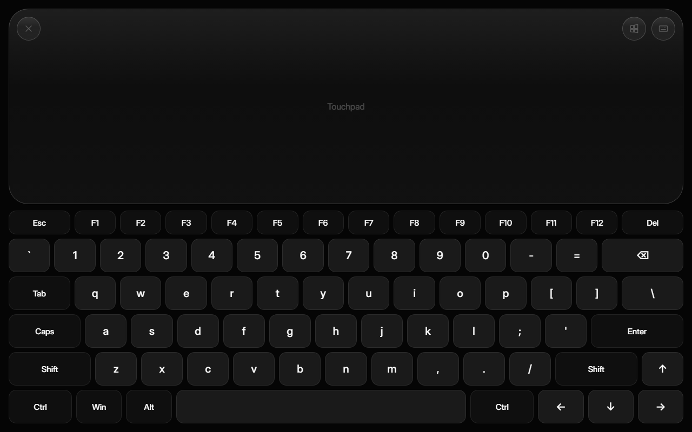
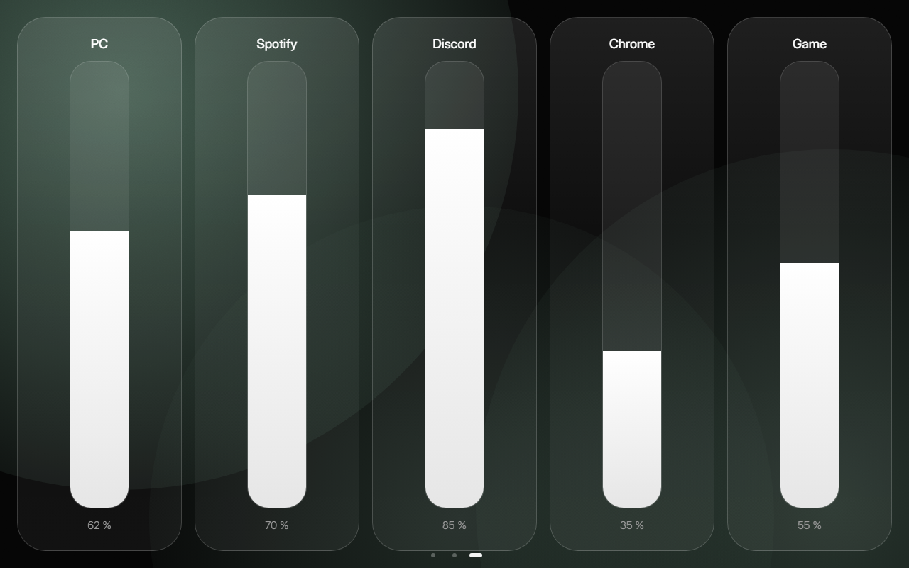
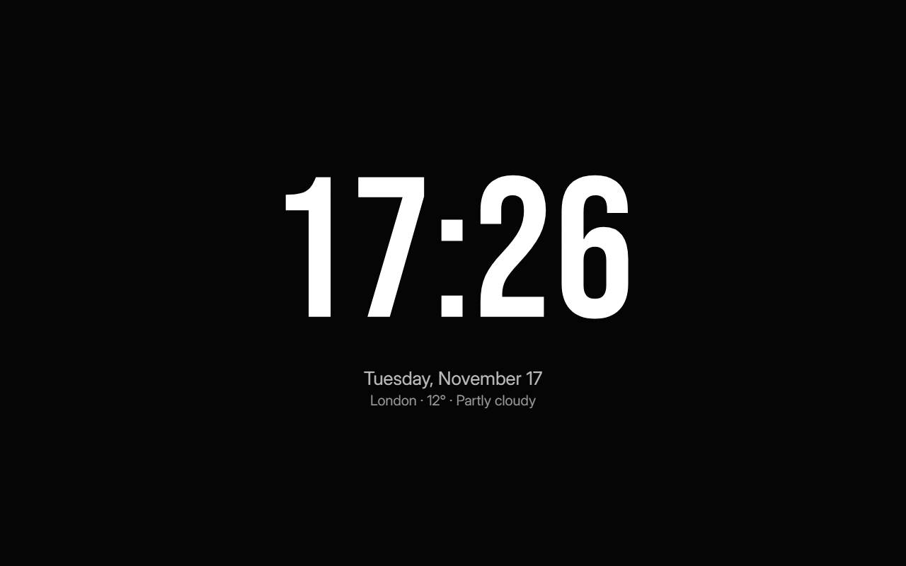

<h1 align="center">Lumen Desk</h1>

<p align="center"><b>Turn your old Android tablet or phone into a free control panel – and home screen – for your Windows PC.</b></p>

<p align="center">
  <a href="https://cyipex.github.io/lumen-desk/"><b>Try the live demo</b></a> ·
  <a href="https://github.com/cyipex/lumen-desk/releases/latest"><b>Download</b></a> ·
  <a href="#install-in-one-command"><b>Install</b></a> ·
  <a href="#everything-it-can-do"><b>All features</b></a>
</p>

<p align="center">
  <a href="https://github.com/cyipex/lumen-desk/actions/workflows/build.yml"></a>
  <a href="https://github.com/cyipex/lumen-desk/releases/latest"></a>
  
  
  <a href="LICENSE"></a>
</p>

<p align="center"><a href="https://cyipex.github.io/lumen-desk/"></a><br>
<sub>The screen with demo data. <a href="https://cyipex.github.io/lumen-desk/">Try it in your browser</a> – no install.</sub></p>

Lumen Desk is a small Windows app plus an Android app for a **tablet or phone**. The device becomes a **Stream-Deck-style panel**: a big clock, Spotify, the volume of every app, one-tap shortcuts, a touchpad and keyboard, a drawing tablet, a presentation remote – or a **second monitor**. It can replace the device's **home screen**, so it always comes back to the panel. Free, open source, no account, no cloud.

## Install in one command

On the PC, open **PowerShell** and paste:

```powershell
irm https://raw.githubusercontent.com/cyipex/lumen-desk/main/get.ps1 | iex
```

It downloads the latest installer from this repo's [Releases](https://github.com/cyipex/lumen-desk/releases/latest), checks its SHA-256 and starts it. Then on the tablet or phone open
**[github.com/cyipex/lumen-desk/releases/latest/download/lumen-desk.apk](https://github.com/cyipex/lumen-desk/releases/latest/download/lumen-desk.apk)**, install it, and allow it on the PC when both show the same 6-digit code. That's it – [step by step below](#set-it-up-step-by-step).

## Why Lumen Desk?

| | Lumen Desk | A Stream Deck |
|---|---|---|
| Price | **Free** – uses the old tablet or phone in your drawer | from about €150 |
| Screen | the whole touch screen of a tablet or phone: clock, Spotify, mixer, any layout | 15 small keys |
| Touchpad, keyboard, drawing tablet, second monitor | ✓ | – |
| Home screen of the device (always returns to the panel) | ✓ | – |
| Works without an account or cloud | ✓ | ✓ |

## Everything it can do

**On the home screen**
- 🕒 **Big clock** in 20 fonts (or your own TTF / OTF), date, weather, CPU and RAM.
- 🎵 **Spotify** – what's playing, play / pause / skip / seek, your playlists and liked songs. Press Play while nothing plays and it **starts Spotify on the PC** (or the web player when the app is not installed).
- 🔊 **Volume** – PC volume, mute, switch speakers / headphones, and a **mixer page with one slider per app** (Spotify, Discord, games…).
- ⚡ **One-tap tiles** – open apps, files and websites (even in a chosen browser profile), keyboard shortcuts, typed text, media keys, lock / sleep / shut down, toggles that light up. Chain them into macros.
- 💡 **Smart lights** – Yeelight bulbs on and off.
- 🔔 **Notifications** from Discord, WhatsApp and other Windows apps pop up on the tablet.
- 🤖 **Claude usage** – your Claude 5-hour and weekly limits, from Claude Code on the PC.
- 📄 Multiple **pages** you swipe between: home, 4 × 3 grid, big 3 × 2 tiles, mixer.

**Tools**
- 🖱️ **Touchpad and keyboard** – tap to click, two fingers to scroll and right click, pinch to zoom, double-tap-and-hold to drag, three fingers to switch apps; a full laptop keyboard with Ctrl / Alt / Win, F-keys, arrows and accented letters.
- 🎤 **Presentation remote** – big Next / Back, a timer, a laser-pointer pad; the tablet's **volume keys switch slides**.
- ✏️ **Drawing tablet** – the tablet surface is a whole PC monitor; draw with a finger in Paint, Photoshop, Krita…
- 🖥️ **Second monitor** – the tablet becomes an extra screen for the PC, with touch.
- 📱 **Lumen Mirror** – see and control an Android phone (for example one with a broken screen) on the tablet.

**The tablet or phone itself**
- 🏠 **Home screen (launcher)** – set Lumen Desk as the device's launcher: after power-on or Home it always goes straight back to the panel, with no app drawer in the way. The device's own apps are one tap away.
- 🌙 **Clock screensaver** after 2 minutes or from its button – your photo, font, position, size and color, set on the PC; one touch closes it without pressing anything underneath.
- 🔋 Battery saving: the screen dims when nobody touches it.
- 📐 Fits any screen: 10″ tablets, 16:9 and 4:3 tablets, and phones held sideways.
- ⬆️ **Updates over Wi-Fi** – the PC offers new versions of the app; no cable needed.

**Your style**
- 🎨 10 background colors, 20 clock fonts plus your own, two player styles – changed on the tablet or the PC, live.
- 🧩 Everything is set up in a **settings window on the PC**: click a tile to choose what it does, drag tiles around, add pages. The PC keeps the **last 30 versions** of your layout to restore with one click.

**Connection and security**
- 📶 Finds the PC by itself on the same Wi-Fi, or uses a **USB cable** (faster, and the tablet charges).
- 🔐 **Encrypted** connection with a pairing code; a website or another device on the network cannot control your PC. [Details](#security).
- 🙈 No account, no cloud, no telemetry.

<table>
  <tr>
    <td></td>
    <td></td>
  </tr>
  <tr>
    <td></td>
    <td></td>
  </tr>
</table>

**Everything is set up on your PC** – click a tile to choose what it does, drag tiles around, add pages:


---

## What you need

- A **Windows 10 or 11** PC
- An **Android tablet or phone** with Android 7 or newer (old tablets are perfect)
- Both on the **same Wi-Fi** – or connected with a USB cable
- Optional: **Spotify Premium** for the music controls

---

## Set it up step by step

> Below it says *tablet* – a **phone** works exactly the same way (hold it sideways).

### Step 1 – On your PC
Use the [one command](#install-in-one-command) above, or download **`LumenDeskSetup.exe`** from the [Releases](../../releases) page and run it (**Next → Install → Finish**).

Lumen Desk runs in the background, starts with Windows, and the **Lumen Desk** icon on your desktop opens the settings. Uninstall it any time in *Windows Settings → Apps*.

> **"Windows protected your PC"?** The installer is not code-signed (that costs money for a free project), so Windows warns about it the first time. Click **More info → Run anyway**.

### Step 2 – On your tablet or phone
1. Download **`lumen-desk.apk`** from the [Releases](../../releases) page – open the link directly on the device.
2. Open the file to install it. If Android asks, allow installing apps from this source.
3. Open **Lumen Desk** on the tablet. It finds your PC by itself.

### Step 3 – Allow the tablet
The tablet shows a 6-digit code. On the PC, open the **Lumen Desk** settings → **Tablet**, check that the same code is shown there and click **Allow**. You only need to do this once.

Done! 🎉 Now make it yours: in the settings window click a tile to change what it does, drag tiles around, add pages, or pick a color under **Appearance** and style the clock under **Screensaver**.

**Make it the home screen:** open the ⚙ settings on the tablet or phone (bottom of the shortcut column) → **Set as default launcher**.

---

## Extras (optional)

<details>
<summary><b>Spotify</b> – control music and browse your library</summary>

1. In the Lumen Desk settings on the PC, open **Spotify**.
2. Follow the three steps shown there: create a free app at [developer.spotify.com](https://developer.spotify.com/dashboard), paste the redirect address it shows, tick **Web API**, and copy the **Client ID** back.
3. Click **Log in to Spotify**.

Without this, the play / next / previous buttons still work (as media keys).
</details>

<details>
<summary><b>Smart lights</b> (Yeelight)</summary>

1. In the Yeelight app, open each bulb → Settings → turn on **LAN Control**.
2. In the Lumen Desk settings: **Lights** → **Search for bulbs**.
3. Click a tile, set *Action* to **Light** and pick the bulb.
</details>

<details>
<summary><b>Second monitor</b> – use the tablet as an extra screen</summary>

1. Install the free [Virtual Display Driver](https://github.com/VirtualDrivers/Virtual-Display-Driver/releases) (*VDD.Control* → **Install Driver**). It adds a virtual monitor to Windows.
2. In the Lumen Desk settings open **Tablet → Extras** and click **Install** next to *Second monitor* (it downloads ffmpeg for you).
3. Press **Win + P** → **Extend**. In *Settings → Display*, set the new monitor to your tablet's resolution (e.g. 1280 × 800).
4. In the Lumen Desk settings, add a tile with the action **Second monitor**.

On the tablet: tap = click, drag = drag, hold = right click, two fingers = scroll, **three-finger tap = back** to the panel.
</details>

<details>
<summary><b>USB cable</b> – faster and steadier than Wi-Fi, and the tablet charges</summary>

1. On the tablet, enable **Developer options** (tap *Build number* 7× in *Settings → About tablet*) and turn on **USB debugging**.
2. In the Lumen Desk settings open **Tablet → Extras** and click **Install** next to *USB cable* (it downloads Google's adb tool for you).
3. Plug the tablet in and accept the *Allow USB debugging* prompt. Lumen Desk switches to the cable by itself.
</details>

<details>
<summary><b>Claude usage</b> – your Claude limits on the home screen</summary>

The installer can't change Claude Code's settings for you. Add this to `%USERPROFILE%\.claude\settings.json`:

```json
"statusLine": { "type": "command", "command": "\"C:/Program Files/Lumen Desk/LumenDesk.exe\" --claude-status" }
```

The numbers come from Claude Code's status line, so they update while you use `claude` in a terminal. Nothing is fetched from the internet and no login is touched.
</details>

---

## Something doesn't work?

| Problem | Try this |
|---|---|
| The tablet keeps *Looking for PC…* | Make sure both are on the same Wi-Fi and Lumen Desk runs on the PC. Tap the connection pill on the tablet for details, or enter the address shown in the PC settings → **Tablet → Connect the tablet**. School, hotel and café Wi-Fi often block devices from seeing each other – use the USB cable there. |
| *The PC does not accept this tablet* | The tablet was paired with another PC or removed on this one. Tap **Pair again** and allow it on the PC. |
| Spotify shows nothing | Press Play on the tablet – Lumen Desk starts Spotify on the PC. |
| Some playlists show no songs | Spotify only lets apps list songs of playlists *you* created; others can still be played with **Play** / **Shuffle**. |
| Second monitor is black | Check that Windows shows two displays (Win + P → Extend) and that *Second monitor* shows **Installed** in **Tablet → Extras**. |
| My layout looks reset | PC settings → **Tablet → Earlier layouts** → **Restore**. |
| Anything else | The settings window → **Tablet** → *Server status* shows a log. Or [open an issue](../../issues/new/choose). |

---

## Install with an AI assistant

Using **Claude Code**, **Codex** or a similar coding agent? Open this folder and say:

> Install Lumen Desk on my PC and tablet by following AGENTS.md.

It will walk you through every step and ask before doing anything important.

---

## Contributing

Ideas, bug reports, translations and code are welcome – see [CONTRIBUTING.md](CONTRIBUTING.md). Issues labelled `good first issue` are a good start. What changed in each version: [CHANGELOG.md](CHANGELOG.md).

## For developers

- `pc/` – Windows server (Node.js 22+, no build step). `run.js` supervises `server.js`; libraries in `lib/`, settings UI in `ui/`, tests in `test/` (`npm test`).
- `pc/installer/` – builds `LumenDeskSetup.exe` (`npm run installer`): the server is bundled with esbuild, packed with Node.js into one exe (Node single executable application) and wrapped with [Inno Setup](https://jrsoftware.org/isinfo.php). It also includes the tablet app, which the PC offers to tablets as an update. User data lives in `%APPDATA%\Lumen Desk`.
- `tablet/` – Android app (Kotlin, Jetpack Compose, Android 7.0+). Build with `./gradlew assembleRelease` (JDK 17, Android SDK 34).
- `phone/` – Lumen Mirror, the phone app.
- `shared/` – icons and clock fonts used by both. `docs/` – the live demo and screenshots (GitHub Pages).

How it works: encrypted WebSocket for the tablet on port 47801, auto-discovery over UDP broadcast (port 47802), the settings window on `http://127.0.0.1:47803` (only reachable from the PC itself). Keyboard, mouse, volume and windows are controlled through small PowerShell helpers (Win32 / Core Audio). The second monitor is captured with ffmpeg `ddagrab`, encoded to H.264 and decoded by the tablet's hardware. Notifications are read from the Windows notification database (read-only). Optional env var `LUMEN_PC_NAME` changes the PC name shown on the tablet.

See [AGENTS.md](AGENTS.md) for details.

### Security
- **Encrypted connection.** Every connection starts with a fresh key exchange (ECDH P-256); all messages, including the second-monitor video, are encrypted and authenticated with AES-256-GCM and numbered, so they cannot be read, changed or replayed on the network.
- **Pairing.** A new tablet and the PC show the same 6-digit code; allow the tablet only when they match. The PC then gives the tablet a random 256-bit pairing key, which is mixed into every later connection – the tablet's id alone is worth nothing to an attacker, and the key itself never travels over the network again.
- **Settings stay on the PC.** The settings window and its API listen only on 127.0.0.1:47803 (not forwarded over the USB cable) and accept requests only from the settings page itself (Host, Origin and a custom header are checked), so a web page open in your browser cannot change macros or run programs.
- Pairing keys and the Spotify login are stored in your Windows user profile (`%APPDATA%\Lumen Desk`); anyone who can log into your Windows account can read them.
- Found a security problem? Please report it privately – see [SECURITY.md](SECURITY.md).

## Credits
Fonts: [Inter](https://rsms.me/inter/) and 20 clock fonts from [Google Fonts](https://fonts.google.com) (SIL Open Font License, licenses in `shared/fonts/licenses`). Weather by [Open-Meteo](https://open-meteo.com). Music via the Spotify Web API. Second monitor uses [Virtual Display Driver](https://github.com/VirtualDrivers/Virtual-Display-Driver) and [ffmpeg](https://ffmpeg.org) – both are installed separately by you and keep their own licenses.

## License
[MIT](LICENSE)
